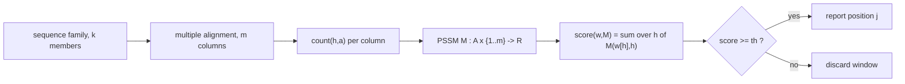

# Position Specific Scoring Matrix

## Definition

A **position specific scoring matrix (PSSM)** (positionsspezifische Scoring-Matrix) is a function

```
M : A × {1, ..., m} -> ℝ
```

i.e. an `|A| × m` matrix whose row `a ∈ A` holds the score of character `a` at each of the
positions `1..m`; `m` is the **length** of `M` (fsa_part3, p. 1). It is the representation of a
multiple alignment of related sequences: each column of the alignment becomes one column of `M`,
holding the **relative frequency** of each nucleotide in that column.

A word `w ∈ A^m` is scored by summing the per-position entries (fsa_part3, p. 1):

```
score(w, M) = Σ_{h=1}^{m} M( w[h], h )
```

Symbols: `A` — alphabet; `m` — PSSM length; `w` — a word of length `m`; `S` — the sequence being
searched, `n = |S|`; `th` — the score threshold.

## Why it matters

Identifying that a sequence belongs to a family often allows inference about its **function**
(fsa_part3, p. 1). A high PSSM score in some region of a sequence therefore indicates a possible
biological relationship of that sequence to the family. A single consensus string loses the
column-wise variability; the PSSM keeps it, which is exactly what makes weak but real motifs
detectable. Contrast [[score-function]], which is position-*independent*.

## Formal definition

A PSSM model of a sequence family is the tuple

| Component | Meaning |
|---|---|
| `A` | the alphabet (`{A,C,G,T}` in the lecture example) |
| `m` | the length of the motif = number of alignment columns |
| `M : A × {1..m} → ℝ` | the score of each character at each position |
| `score(w,M) = Σ_{h=1}^m M(w[h],h)` | the additive scoring rule, `w ∈ A^m` |
| `th ∈ ℝ` | the reporting threshold |

**PSSM searching problem** (fsa_part3, p. 1): given `M` of length `m`, a sequence `S` with
`|S| = n` and a threshold `th`, find **all** positions `j`, `1 ≤ j ≤ n−m+1`, with

```
score( S[j .. j+m-1], M ) >= th
```

> [!warning]
> The model has **no states and no transitions** — positions are scored independently. Any
> dependency between adjacent positions is outside the model; that is the step up to a
> [[hidden-markov-model]].

## Parameters and how they are estimated

The parameters are the `|A| · m` entries of `M`. They are estimated from a multiple alignment of
the family by **column-wise relative frequencies** (fsa_part3, p. 1):

```
M(a, h) <- count(h, a) / k        // k = number of family members
```

where `count(h, a)` is the number of family members carrying `a` in column `h` (the same counting
function as in [[multiple-sequence-alignment]], p. 16).

> [!note] Outside source
> Frequencies of `0` make any word containing that character unscorable in a log-odds setting and
> brittle in an additive one; the standard remedy is [[pseudocounts]], covered in the GIK module,
> not in fsa_part3.

## Model diagram



## Construction / Mechanism

Slide a window of length `m` over `S` and evaluate `score(S[j..j+m−1], M)` for every start position
`j`, `1 ≤ j ≤ n−m+1` (fsa_part3, p. 2). Each score costs `O(m)`, giving `O(mn)`. The early-abort
improvement is [[pssm-lookahead-search]].

## Pseudocode

```text
ALGORITHM BuildPSSM(family s_1..s_k aligned, each of length m, alphabet A)
  for h = 1 to m:
    for each a in A:  count[h][a] <- 0
  for i = 1 to k:
    for h = 1 to m:
      count[h][ s_i[h] ] <- count[h][ s_i[h] ] + 1
  for h = 1 to m:
    for each a in A:  M[a][h] <- count[h][a] / k
  return M

ALGORITHM PSSMSearchNaive(S[1..n], M, m, th)
  Hits <- empty list
  for j = 1 to n - m + 1:
    sc <- 0
    for h = 1 to m:
      sc <- sc + M[ S[j+h-1] ][ h ]
    if sc >= th:  append j to Hits
  return Hits
```

## Complexity

| Operation | Time | Space |
|---|---:|---:|
| Build `M` from `k` aligned family members | `O(k·m + \|A\|·m)` | `O(\|A\|·m)` |
| `score(w, M)` for one word | `O(m)` | `O(1)` |
| Naive PSSM search over `S` | `O(mn)` (fsa_part3, p. 2) | `O(\|A\|·m)` |
| Look-ahead PSSM search | `O(kn)` avg, `O(mn)` worst | `O(\|A\|·m + m)` |

(`k` in the last row is the average number of PSSM positions evaluated per sequence position —
see the symbol-clash warning below.)

## Worked example

Family of `k = 5` sequences (fsa_part3, p. 1):

```
G T A T
G G C G
T T C G
G T C A
G T T A
```

Column counts and the resulting PSSM (relative frequencies, `m = 4`):

| base | 1 | 2 | 3 | 4 |
|---|---:|---:|---:|---:|
| **A** | 0 | 0 | 0.2 | 0.4 |
| **C** | 0 | 0 | 0.6 | 0 |
| **G** | 0.8 | 0.2 | 0 | 0.4 |
| **T** | 0.2 | 0.8 | 0.2 | 0.2 |

Check: column 1 is `G,G,T,G,G` → `G: 4/5 = 0.8`, `T: 1/5 = 0.2` ✓. Every column sums to 1.

Scoring the family members and a non-member:

| `w` | `M(w[1],1)` | `M(w[2],2)` | `M(w[3],3)` | `M(w[4],4)` | `score(w,M)` |
|---|---:|---:|---:|---:|---:|
| `GTCA` | 0.8 | 0.8 | 0.6 | 0.4 | **2.6** |
| `GTTA` | 0.8 | 0.8 | 0.2 | 0.4 | 2.2 |
| `GTAT` | 0.8 | 0.8 | 0.2 | 0.2 | 2.0 |
| `GGCG` | 0.8 | 0.2 | 0.6 | 0.4 | 2.0 |
| `TTCG` | 0.2 | 0.8 | 0.6 | 0.4 | 2.0 |
| `AAAA` | 0 | 0 | 0.2 | 0.4 | 0.6 |

`GTCA` is the best-scoring word; note it is also the column-wise consensus `G T C A`, which here
happens to be a family member. With `th = 2.0` every family member is reported and `AAAA` is not.

> [!question]
> The handwritten row labels on p. 1 transcribe as `A, T, G, T`. Only `A, C, G, T` is consistent
> with the data (the `0.6` in column 3 must be `C`, which occurs three times there). The table
> above assumes that reading.

## Pitfalls & exam traps

> [!warning]
> - The matrix is `|A| × m`: **rows are characters, columns are positions**. Transposing it is the
>   classic exam error.
> - `score` is a **sum**, not a product — the entries are frequencies but they are added, so this
>   is not a likelihood. A log-odds reading would require `log`; see [[log-odds-score]].
> - Scanning positions run `1 ≤ j ≤ n−m+1`, not `1 ≤ j ≤ n`. There are `n−m+1` windows.
> - The threshold comparison is `≥ th`, not `> th`.
> - A frequency of `0` silently caps the score of every word using that character at that position;
>   it does not forbid the word.
> - Symbol clash inside part 3: `k` is the family size on p. 1, the *average number of evaluated
>   positions* on p. 2, the number of sequences from p. 15 on, and the mismatch bound on pp. 6–9.
>   Read `k` from its context.

## Related

- [[pssm-lookahead-search]] — the early-abort search algorithm for exactly this model.
- [[score-function]] — position-*independent* scoring; the PSSM is its position-dependent
  generalisation.
- [[log-odds-score]] — how raw frequencies are normally turned into additive scores.
- [[multiple-sequence-alignment]] — supplies the aligned family the matrix is estimated from, and
  shares the `count(j,a)` function.
- [[hidden-markov-model]] — adds state transitions, the thing a PSSM deliberately lacks.
- [[blast]] — profile scoring is the natural extension of its `score_σ` for iterated search.
- [[pseudocounts]] — the standard fix for zero frequencies.
- [[fsa_part3]] — source page for this unit.

## Sources

- fsa_part3, pp. 1–2 (`raw/foundations_sequence_analysis_part3.pdf`)
