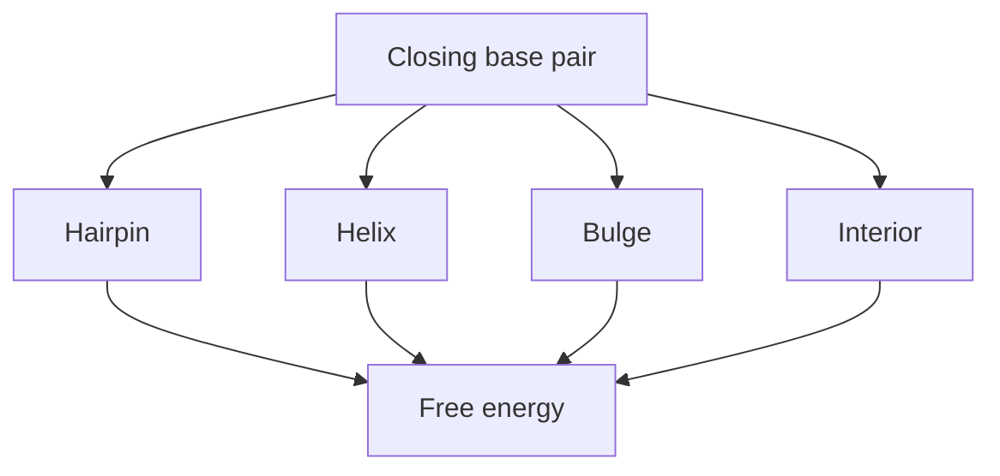

# RNA Free Energy Model

## Definition

An RNA free energy model assigns energy to an [[rna-secondary-structure]]; the predicted fold is the legal structure of minimum free energy (gik_3_4, p. 4).

## Formal definition

Independent-pair model: `E_fe(S_w)=Σ_(i,j in S_w) α(w[i],w[j])`, where `α(x,y)` is the energy of pairing bases `x,y`; stabilising pairs have `α(x,y)<0` (gik_3_4, p. 4).

Loop-aware model: use separate functions for hairpin loops, helical/stacked regions, bulges, and interior loops (gik_3_4, pp. 8-12).

## Parameters and how they are estimated

The notes name the functions `α`, hairpin penalty, stacking/helical contribution, bulge penalty, and interior-loop penalty, but do not include thermodynamic tables (gik_3_4, p. 12).

> [!note] Inference
> Treat those functions as given by the lecture model; do not invent parameter values.

## Model diagram

## Construction / Mechanism

Independent pairs ignore neighbouring pairs. Loop-aware energy asks whether `(i,j)` closes a hairpin, extends `(i+1,j-1)` as a helix, or bounds one-sided/two-sided unpaired regions (gik_3_4, pp. 8-12).

## Complexity

| Use | Time | Space |
|---|---:|---:|
| Score fixed structure with `b` pairs | `O(b)` | `O(1)` extra |
| Optimise independent model | `O(n^3)` | `O(n^2)` |
| Optimise unrestricted loop model | `O(n^4)` | `O(n^2)` |

## Worked example

For pairs `{(1,6),(2,5)}`, the independent score is `α(w[1],w[6])+α(w[2],w[5])`. In the loop model these adjacent nested pairs form a helical/stacked region instead of two unrelated events (gik_3_4, pp. 4, 12).

## Pitfalls & exam traps

> [!warning]
> - Minimum energy means more negative is better.
> - Independent-pair and loop-aware recurrences optimise different objectives.
> - Missing numerical energy tables are an open source gap.

## Related

- [[nussinov-algorithm]] — independent-pair optimiser.
- [[rna-loop-energy-dp]] — loop-aware optimiser.
- [[rna-secondary-structure]] — legal structures being scored.

## Sources

- gik_3_4, pp. 4, 8-12
