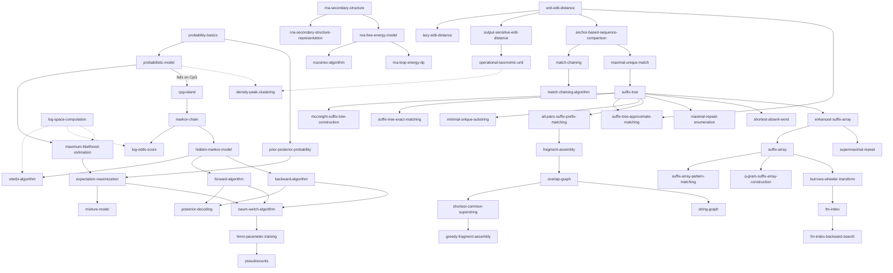
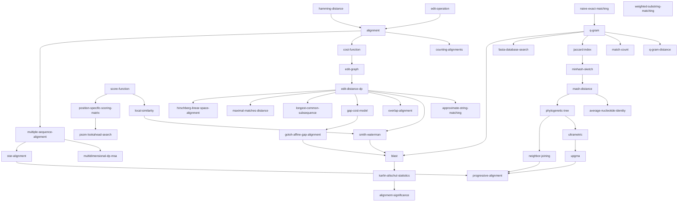

# Modules at a glance

This wiki covers **two modules**:

- **GIK — Genome Informatics**, units 1–6 — see *Genome Informatics (GIK) — Overview* below.
- **GSA — Grundlagen der Sequenzanalyse**, parts 1–3 plus an exam question catalogue — see
  *Foundations of Sequence Analysis (GSA) — Overview* below.

Pages carry a `module:` frontmatter key. GIK pages predate the key and are implicitly `module: GIK`;
every GSA page sets `module: GSA` explicitly. On GSA pages, `units: [N]` means **FSA part N**.

---

# Genome Informatics (GIK) — Overview

The module at a glance. Lecture and exercises are taught together, so each unit below should
end up with both its theory pages and its exercise page.

## Units

| Source | Units | Topics | Status |
|---|---|---|---|
| `raw/gik_1_2.pdf` | 1–2 | probabilistic models, MLE, Bayes, EM, mixture models; CpG islands, Markov chains, HMMs, Viterbi/Forward/Backward, posterior decoding, Baum–Welch | [[gik_1_2\|ingested]] |
| `raw/gik_3_4.pdf` | 3–4 | RNA secondary structure, MFE folding, Nussinov, loop energy; unit edit distance, lazy and output-sensitive edit distance; OTUs, anchor-based comparison, match chaining | [[gik_3_4\|ingested]] |
| `raw/gik_5.pdf` | 5 | suffix trees, McCreight construction, exact and approximate pattern matching, minimal/maximal unique matches, all-pairs suffix-prefix overlaps, maximal repeats, enhanced suffix arrays | [[gik_5\|ingested]] |
| `raw/gik_6.pdf` | 6 | suffix arrays, LCP local maxima, supermaximal repeats, BWT, FM-index, fragment assembly, overlap/string graphs, shortest common superstring, density-peak clustering | [[gik_6\|ingested]] |

## The complete arc

Unit 1 builds a general probabilistic toolkit; unit 2 applies it to sequences. The bridge is the
observation that a position-independent model cannot explain CpG dinucleotide frequencies, which
forces conditioning on context — first observable ([[markov-chain]]), then hidden
([[hidden-markov-model]]). Units 3–4 shift to dynamic programming over biological structures:
RNA intervals for [[rna-secondary-structure]], edit-distance matrices/fronts, and
[[match-chaining]] over anchor matches. Unit 5 supplies the indexing machinery behind those
anchors: [[suffix-tree]], suffix-tree search, MUMs and enhanced suffix arrays. Unit 6 completes
the indexing arc by replacing tree navigation with [[suffix-array|suffix arrays]],
[[burrows-wheeler-transform|BWT]] and [[fm-index|FM-indexes]], then uses overlaps for
[[fragment-assembly]] and closes with [[density-peak-clustering]] for gene-expression profiles.

The module therefore moves from **probability** to **sequence models**, then to **dynamic
programming**, **string indexes**, **assembly graphs**, and finally **clustering**. The final
through-line is: biological sequences are too large for naive search, too noisy for exact global
rules, and too structured for independent models; every unit introduces the representation that
makes the next analysis tractable.

Three themes recur across the whole module:

1. **Hidden variables force iteration.** Closed-form MLE exists only when everything is
   observed. [[expectation-maximization]] (unit 1) and [[baum-welch-algorithm|Baum–Welch]]
   (unit 2) are the same algorithm applied to different models.
2. **Logs everywhere.** [[log-space-computation]] appears in MLE, in the
   [[log-odds-score]], in [[viterbi-algorithm|Viterbi]], and in both exercise sheets.
3. **Intervals and graphs replace brute force.** RNA uses intervals, suffix indexes turn matches
   into suffix intervals, and assembly turns overlaps into paths in [[overlap-graph|overlap]] and
   [[string-graph|string graphs]].

## Topic dependency graph

Pages in the graph: [[probability-basics]], [[probabilistic-model]],
[[prior-posterior-probability]], [[maximum-likelihood-estimation]], [[expectation-maximization]],
[[mixture-model]], [[cpg-island]], [[markov-chain]], [[log-odds-score]],
[[hidden-markov-model]], [[viterbi-algorithm]], [[forward-algorithm]], [[backward-algorithm]],
[[posterior-decoding]], [[baum-welch-algorithm]], [[hmm-parameter-training]], [[pseudocounts]],
[[log-space-computation]]. Also: [[sigmoid-function]],
[[numerical-integration-midpoint]], [[hmm-three-problems]], [[hmm-tables-comparison]],
[[sheet-01]], [[sheet-02]], [[rna-secondary-structure]],
[[rna-secondary-structure-representation]], [[rna-free-energy-model]],
[[nussinov-algorithm]], [[rna-loop-energy-dp]], [[unit-edit-distance]],
[[lazy-edit-distance]], [[output-sensitive-edit-distance]], [[operational-taxonomic-unit]],
[[anchor-based-sequence-comparison]], [[match-chaining]], [[match-chaining-algorithm]],
[[sheet-03]], [[sheet-04]], [[suffix-tree]], [[mccreight-suffix-tree-construction]],
[[suffix-tree-exact-matching]], [[suffix-tree-approximate-matching]],
[[minimal-unique-substring]], [[maximal-unique-match]],
[[all-pairs-suffix-prefix-matching]], [[maximal-repeat-enumeration]],
[[shortest-absent-word]], [[enhanced-suffix-array]], [[sheet-05]],
[[suffix-array]], [[suffix-array-pattern-matching]],
[[q-gram-suffix-array-construction]], [[supermaximal-repeat]],
[[burrows-wheeler-transform]], [[fm-index]], [[fm-index-backward-search]],
[[fragment-assembly]], [[overlap-graph]], [[shortest-common-superstring]],
[[greedy-fragment-assembly]], [[string-graph]], [[density-peak-clustering]], [[sheet-06]].

## Related

- [[index]] — full page catalog.
- [[exam-prep]] — condensed revision sheet.
- [[log]] — what was done and when.

---

# Foundations of Sequence Analysis (GSA) — Overview

*Grundlagen der Sequenzanalyse.* Three parts of continuous lecture notes plus an exam question
catalogue. Where GIK is a tour of **models and indexes**, GSA is a single sustained development of
**sequence comparison**: what it means for two sequences to be similar, how to compute that
efficiently, how to decide whether the answer is meaningful, and how to scale it from two
sequences to many.

## Parts

| Source | Part | Topics | Status |
|---|---|---|---|
| `raw/foundations_sequence_analysis_part1.pdf` | 1 | edit operations and scripts, alignments and the length lemma, counting alignments, cost functions and metrics, the edit graph, the edit-distance DP and traceback, scores and BLOSUM62, local similarity and Smith–Waterman, approximate and exact string matching, overlap alignment, general and affine gap costs | [[fsa_part1\|ingested]] |
| `raw/foundations_seqzence_analysis_part2.pdf` | 2 | LCS and the LCS graph, maximal-match distance and the `mmm` metric, q-grams and q-gram distance, match count, weighted substring matching, Jaccard index, MinHash sketches and Mash distance, ANI, FASTA, BLAST, Karlin–Altschul statistics | [[fsa_part2\|ingested]] |
| `raw/foundations_sequence_analysis_part3.pdf` | 3 | PSSMs and look-ahead search, statistical significance of local alignments, Hirschberg linear-space alignment, multiple sequence alignment and sum-of-pairs, multidimensional DP, star alignment and the `2 − 2/k` bound, progressive alignment, phylogenetic trees, additivity, ultrametrics, UPGMA, Neighbor Joining | [[fsa_part3\|ingested]] |
| `raw/foundations_sequence_analysis_fragenkatalog.pdf` | — | exam question catalogue: 72 questions in §1–§11 with handwritten answers | [[fsa_fragenkatalog\|ingested]] |

> [!warning]
> The part-2 file name is misspelled in `raw/` — `foundations_seqzence_analysis_part2.pdf`, not
> "sequence". `raw/` is immutable, so the typo stays; cite it as `fsa_part2` regardless.

## The complete arc

Part 1 builds the whole of pairwise comparison from one idea: an [[alignment]] is a path in the
[[edit-graph]], so the best alignment is a shortest path in a DAG. Everything else in part 1 is a
variation on the boundary conditions of that single DP — free the start and you get
[[approximate-string-matching]], free start and end and add a floor of `0` and you get
[[smith-waterman]], free one sequence's suffix and the other's prefix and you get
[[overlap-alignment]]. The [[cost-function]] is the only biological input, and
[[gap-cost-model|gap costs]] are the first place where the "cost of a cell depends only on three
neighbours" assumption breaks, forcing the three matrices of [[gotoh-affine-gap-alignment]].

Part 2 abandons alignment entirely. `O(mn)` is too slow for a database, so comparison is replaced
by **counting shared substrings**: [[q-gram|q-grams]], [[q-gram-distance]],
[[maximal-matches-distance]]. These are cheap and provably **lower-bound** the edit distance, so
they work as *filters* — discard a pair without ever running the DP. Compress the q-gram set
further into a [[minhash-sketch|sketch]] and you get [[jaccard-index|Jaccard]] estimates and
[[mash-distance]] at constant space per sequence. The same q-grams then become *seeds*:
[[fasta-database-search|FASTA]] and [[blast|BLAST]] use them to find where an expensive alignment
is worth running, and [[karlin-altschul-statistics]] says whether the result means anything.

Part 3 scales up in two directions. **Space:** [[hirschberg-linear-space-alignment|Hirschberg]]
recovers the alignment itself in `O(m+n)` space. **Number of sequences:**
[[multiple-sequence-alignment]] is exact but exponential
([[multidimensional-dp-msa]]), so it is approximated by [[star-alignment]] — which comes with a
provable `2 − 2/k` guarantee — or heuristically by [[progressive-alignment]] along a guide tree.
Building that guide tree is itself a distance problem, which closes the loop back to part 2:
pairwise distances feed [[upgma]] and [[neighbor-joining]], and whether those reconstruct the true
[[phylogenetic-tree]] depends on whether the distance is additive or [[ultrametric]].

The through-line: **exact comparison is a shortest path, approximate comparison is a filter, and
every scaling step trades a provable bound for speed.**

Three themes recur:

1. **Lower bounds make filters.** `mmdist <= edist` and `qgdist/(2q) <= edist` are what license
   discarding a pair unseen. The `2 − 2/k` star-alignment bound is the same move applied to
   quality instead of speed.
2. **Boundary conditions select the problem.** Global, semi-global, local, overlap and approximate
   matching are one DP with different initialisations and different traceback start cells.
3. **Seeds then extend.** FASTA, BLAST and anchor-based comparison all find cheap exact seeds
   first and spend alignment time only around them.

## Topic dependency graph

Pages in the graph: [[edit-operation]], [[alignment]], [[counting-alignments]],
[[cost-function]], [[edit-graph]], [[edit-distance-dp]], [[approximate-string-matching]],
[[score-function]], [[local-similarity]], [[smith-waterman]], [[overlap-alignment]],
[[gap-cost-model]], [[gotoh-affine-gap-alignment]], [[hamming-distance]],
[[naive-exact-matching]], [[longest-common-subsequence]], [[maximal-matches-distance]],
[[q-gram]], [[q-gram-distance]], [[match-count]], [[jaccard-index]], [[minhash-sketch]],
[[mash-distance]], [[average-nucleotide-identity]], [[fasta-database-search]], [[blast]],
[[karlin-altschul-statistics]], [[alignment-significance]],
[[position-specific-scoring-matrix]], [[pssm-lookahead-search]],
[[hirschberg-linear-space-alignment]], [[multiple-sequence-alignment]],
[[multidimensional-dp-msa]], [[star-alignment]], [[progressive-alignment]],
[[phylogenetic-tree]], [[ultrametric]], [[upgma]], [[neighbor-joining]],
[[weighted-substring-matching]]. Exam drilling: [[fsa-fragenkatalog]] with
[[fsa-fragenkatalog-1]], [[fsa-fragenkatalog-2]], [[fsa-fragenkatalog-3]],
[[fsa-fragenkatalog-4]].

## Where the two modules touch

GIK and GSA overlap on edit distance and on indexing, from different angles:

- [[unit-edit-distance]] (GIK units 3–4) and [[edit-distance-dp]] (GSA part 1) are the same DP;
  GIK goes on to [[lazy-edit-distance]] and [[output-sensitive-edit-distance]], GSA goes on to
  alignment variants and gap costs.
- [[suffix-tree]] (GIK unit 5) is the index GSA part 2 assumes when it computes
  [[maximal-matches-distance]] in `O(|A|(m+n))`.
- [[anchor-based-sequence-comparison]] and [[match-chaining]] (GIK units 4–5) are the same
  seed-and-extend idea as [[fasta-database-search]] and [[blast]] (GSA part 2).
- [[fragment-assembly]] (GIK unit 6) and [[overlap-alignment]] (GSA part 1) meet at the overlap
  computation; GIK builds [[overlap-graph|overlap graphs]] from it, GSA derives the DP.
- [[q-gram]] (GSA part 2) and [[q-gram-suffix-array-construction]] (GIK unit 6) use the same
  integer coding of fixed-length substrings.
- [[density-peak-clustering]] and [[operational-taxonomic-unit]] (GIK) cluster on exactly the
  kind of distance matrix that [[mash-distance]] produces and that [[upgma]] consumes.

## Related

- [[index]] — full page catalog.
- [[exam-prep]] — condensed revision sheet.
- [[log]] — what was done and when.
