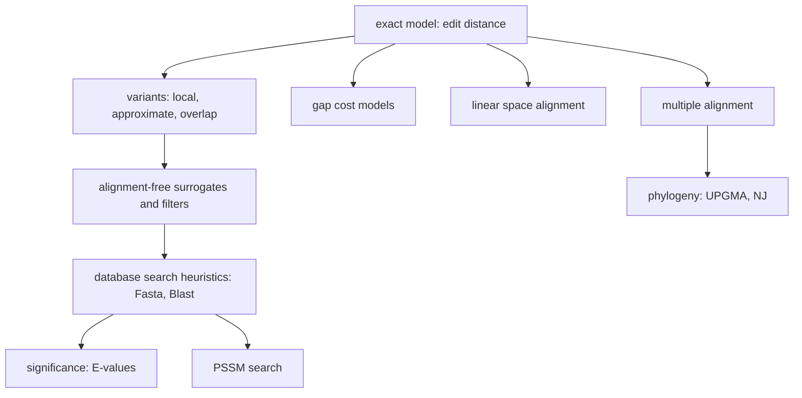

# FSA Fragenkatalog — Exam Question Catalogue (source)

Raw file: `raw/foundations_sequence_analysis_fragenkatalog.pdf` — 36 scanned pages.
Header (p. 1): Arbeitsgruppe Genominformatik / Stefan Kurtz, Universität Hamburg, Zentrum für
Bioinformatik; *"Fragen zur Vorbereitung auf die Prüfung im Modul Grundlagen der Sequenzanalyse,
30. Januar 2023"*. German throughout, rendered into English for this wiki.

> [!warning]
> This is the **GSA** module (Grundlagen der Sequenzanalyse / Foundations of Sequence Analysis),
> *not* the GIK (Genome Informatics) module covering units 1–6 elsewhere in this wiki. Pages from
> this source carry `module: GSA` and `units: [1, 2, 3]` — the catalogue spans all three parts of
> the lecture.

## Scope

| Pages | Content |
|---|---|
| 1–9 | The printed German question catalogue, §1–§11, heavily highlighted with a few marginal notes |
| 10–36 | Handwritten answer sheets, German with English fragments, same numbering |

| Section | Topic | Questions | Answer pages |
|---|---|---|---|
| §1 | The model of edit distance | Q1.1–Q1.20 (Q1.20.1–.3) | 10–15 |
| §2 | Variants of the edit-distance model | Q2.1–Q2.7 | 16–18 |
| §3 | Special gap costs | Q3.1–Q3.3 | 19 |
| §4 | Sequence comparison without alignments | Q4.1–Q4.14 (Q4.2.1/.2, Q4.5.1/.2) | 20–24 |
| §5 | Significance computation of alignments | Q5.1–Q5.3 | 25 |
| §6 | Fasta | Q6.1–Q6.3 | 26 |
| §7 | Blast | Q7.1–Q7.3 | 27 |
| §8 | PSSMs | Q8.1–Q8.2 | 28 |
| §9 | Alignment in linear space | Q9.1–Q9.3 | 29–30 |
| §10 | MSAs | Q10.1–Q10.9 | 31–34 |
| §11 | Phylogeny | Q11.1–Q11.4 | 35–36 |

This is not a lecture script: it is the examiner's own statement of what is examinable, together
with one student's worked answers. It therefore acts as the **authoritative scope boundary** for
the GSA module and as the single highest-value revision artefact in this wiki.

## Key takeaways

- The catalogue is dominated by **definition and recurrence** questions. `E_δ`, `L_σ`, `D_δ` and
  the k-dimensional `M` each appear twice: once asking for the *property* and once for the
  *recurrence* → [[edit-distance-dp]], [[smith-waterman]], [[approximate-string-matching]],
  [[multidimensional-dp-msa]].
- The edit-distance model is specified via [[edit-operation]] pairs
  `(α,β) ∈ (A ∪ {ε})² \ {(ε,ε)}`, alignments as sequences of such pairs, and
  [[cost-function]] `δ`; `edist_δ(u,v) = min{δ(A)}` → [[alignment]].
- The [[edit-graph]] is the answer to "represent all alignments in `O(mn)` space" (Q1.5), to the
  shortest-path reading of `E_δ` (Q1.11), and to the crosspoint definition in §9 — plus three
  purely graph-theoretic questions (graph, path, topological order).
- [[counting-alignments]]: `Aligns(m,n) = Aligns(m-1,n) + Aligns(m-1,n-1) + Aligns(m,n-1)` with
  base case `1` when `m = 0` or `n = 0` (Q1.4).
- Antidiagonal evaluation: `m+n+1` antidiagonals, membership `i+j = a`, dependency on `a-1` and
  `a-2` (Q1.20) → [[edit-distance-dp]].
- Approximate matching differs from global alignment **only in the first row** (`D_δ(0,j) = 0`);
  maximal hit length `O(m+k)` (Q2.5, Q2.6) → [[approximate-string-matching]].
- The gap-cost hierarchy: linear ⊂ affine ⊂ general, with the general model costing `O(mn(n+m))`
  (Q3.1–Q3.3) → [[gap-cost-model]], [[gotoh-affine-gap-alignment]].
- Alignment-free measures as **filters** bounding `edist_δ` from below:
  `mmdist(v,u) ≤ edist_δ(v,u)` and `qgdist(u,v)/(2q) ≤ edist_δ(u,v)`
  → [[maximal-matches-distance]], [[q-gram-distance]].
- q-word integer coding `code(w) = Σ code(w[i])·r^{q-i}` with the constant-time rolling update
  `code(xc) = (code(ax) − code(a)·r^{q-1})·r + code(c)` (Q4.7, Q4.8) → [[q-gram]].
- [[jaccard-index]] `J(U,V) = |U∩V|/|U∪V|`: undefined for `U = V = ∅`, minimal 0 for disjoint
  sets, maximal 1 for `U = V` (Q4.12); sketch cost `O(m(q+log s)) = O(m log s)` with a min-heap
  (Q4.13) → [[minhash-sketch]], [[mash-distance]].
- E-values are **expected counts under a random model**, and the count of maximal exact hits of
  length `≥ ℓ` equals the count of left-maximal hits of length exactly `ℓ` by a bijection
  (Q5.1, Q5.2) → [[alignment-significance]], [[karlin-altschul-statistics]].
- `score_fasta = max_d hotsp(u,w,d)` computed in one scan of `u` against the precomputed query
  table `h_w` (Q6.1–Q6.3) → [[fasta-database-search]].
- A Blast hit is a **scored**, not exact, q-word pair, found via the k-environment `Env_k(w)`;
  ungapped extension stops at `X_max − X_d` and yields an MSP (Q7.1–Q7.3) → [[blast]].
- A PSSM is `M : A × {1..m} → R` derived from a family MSA; search is `O(kn)` with lookahead,
  `O(mn)` worst case (Q8.1, Q8.2) → [[position-specific-scoring-matrix]],
  [[pssm-lookahead-search]].
- Linear-space alignment: crosspoints are monotone (`j₀ < j₀'`, `i₀ ≤ i₀'`), recursion depth
  `O(log₂ n)`, total work `Σ (1/2^i)·(3/2)(m+1)(n+1) ≤ 3(m+1)(n+1) = O(mn)` (Q9.1–Q9.3)
  → [[hirschberg-linear-space-alignment]].
- MSA: three defining properties, consensus vs sum-of-pairs costs, `z = ∏(n_i+1)` entries computed
  in `O(z·f(k)·2^k)`, star alignment within `(2 − 2/k)` of optimal and usable as a pruning bound
  (Q10.1–Q10.8) → [[multiple-sequence-alignment]], [[multidimensional-dp-msa]],
  [[star-alignment]], [[progressive-alignment]].
- Phylogeny: UPGMA needs **additive and ultrametric** `d`, merges by average linkage
  `d(C_i,C_j) = (1/(|C_i||C_j|))ΣΣ d(x,y)` at height `½d`; neighbor joining corrects with
  `N_ij = d(i,j) − (r_i + r_j)` and produces unrooted trees (Q11.1–Q11.4) → [[upgma]],
  [[ultrametric]], [[neighbor-joining]], [[phylogenetic-tree]].

## Lecture content

The catalogue has no lecture text of its own; it is a question list plus answers. Its implied
syllabus, however, is a coherent arc:

**§1–§3 — the model and its parameters.** Everything is derived from one object: an alignment as a
sequence of edit operations, scored by a cost function. Varying *where* the optimisation is
anchored gives global (`E_δ`), local (`L_σ`) and approximate-matching (`D_δ`) DP; varying *how gaps
are charged* gives the linear/affine/general hierarchy. The edit graph is the structural view that
makes "all optimal alignments" a shortest-path set rather than an enumeration.

**§4 — abandoning alignment.** When `O(mn)` per pair is unaffordable, replace the distance by a
cheap surrogate that *lower-bounds* it, so that thresholded searches remain complete. `mmdist` does
this via decompositions into substrings of the other sequence; `qgdist` via `L1` distance on q-word
profiles; `J` and the Mash sketch via set overlap on hashed q-grams.

**§5–§8 — making heuristic search trustworthy.** Fasta and Blast both reduce to "count or score
short word hits, then extend the promising ones"; §5 supplies the statistics needed to say whether
an extension's score means anything, and §8 generalises the query from a string to a profile.

**§9–§11 — scaling up.** §9 fixes alignment's space consumption without giving up optimality;
§10 lifts alignment from 2 to `k` sequences and immediately confronts the exponential cost, met
with the star heuristic and its provable `2 − 2/k` guarantee; §11 turns pairwise distances into
trees.

## Exercises

The catalogue *is* the exercise material. Its structure:

- **72 printed question items** across 11 sections (counting the numbered items at the level at
  which they are printed), expanding to **75 individually answerable items** once the sub-items
  Q1.20.1–.3, Q4.2.1–.2 and Q4.5.1–.2 are unfolded. Section sizes: §1 is by far the largest
  (22 items), then §4 (16) and §10 (9); §3, §5, §6, §7, §9 and §11 have 3 or 4 each, §8 has 2.
- **Question types.** Roughly: "define X precisely" (≈ 30 items), "state the recurrence"
  (Q1.12, Q2.2), "which running time / space" (Q1.14, Q2.5, Q3.2, Q4.3, Q4.9, Q4.13, Q8.2, Q9.2,
  Q10.5), "give a counterexample" (Q4.2.1, Q4.6), "describe the method in at most three sentences"
  (Q1.16, Q2.3), and three concrete hand-computations.
- **The three computational tasks**, which are the ones most likely to be reproduced verbatim:
  - **Q1.13** — fill in the missing last column of the `E_δ` matrix for `u = gcact`,
    `v = tgatat` under the unit-cost function. Answer column `6, 5, 5, 4, 4, 4`;
    `edist_δ = E_δ(5,6) = 4`. Traceback priority `R > D > I`.
  - **Q4.10** — count q-word hits between `u = aaca` and `v = acacaacc` for `q = 2`;
    answer `6 = 1 + 3 + 2`.
  - **Q9.3** — read the marked optimal path off the `9 × 9` edit graph of `u = acactcag`,
    `v = actacacg` (`edist = 3`), write out the crosspoint list(s) and the two-row alignment
    `ac-actcag` / `actacac-g`.
- **Generalizable lesson.** Nearly every "how is this used?" question has the same answer shape:
  the cheap quantity is a *bound* on the expensive one, so it can be used as a filter (Q4.4, Q4.11)
  or as a pruning bound (Q10.8). Recognising that shape answers several questions at once.

The full question-by-question rendering lives on [[fsa-fragenkatalog]] and its four part pages
[[fsa-fragenkatalog-1]], [[fsa-fragenkatalog-2]], [[fsa-fragenkatalog-3]],
[[fsa-fragenkatalog-4]].

## Pages created / updated by this ingest

- created: [[fsa-fragenkatalog]], [[fsa-fragenkatalog-1]], [[fsa-fragenkatalog-2]],
  [[fsa-fragenkatalog-3]], [[fsa-fragenkatalog-4]]
- updated: none from this page (concept pages are maintained separately)

## Open questions / unclear in source

### Coverage gaps — questions with no dedicated concept page

> [!question]
> **Q1.17–Q1.19 — elementary graph theory.** Graph, path, topological order are asked as
> standalone definitions. No general graph-theory page exists; they are carried on [[edit-graph]]
> as background to the edit graph itself.

> [!question]
> **Q4.14 — Poisson distribution.** The catalogue asks for the *definition* of the Poisson
> distribution and its applicability conditions. No page covers the distribution in its own right;
> the applicability conditions are carried by [[mash-distance]] via the mutation model. The
> definition is also **not given in the source** — the answer sheet lists only the conditions.

> [!question]
> **Q5.3 — binomial coefficients.** Pure combinatorics (`n choose k`); no page exists. Filed under
> [[alignment-significance]] as a prerequisite.

> [!question]
> **Q2.7 — overlap problem.** Covered jointly by [[overlap-alignment]] and [[fragment-assembly]];
> no page is specific to the pairwise-read decision problem as the catalogue phrases it.

### Inconsistencies and illegible passages

> [!question]
> **p. 2 vs p. 13 — traceback priority.** The printed margin reads `R > D > L`, the answer sheet
> `R > D > I`. Same convention, two namings of the insertion predecessor ("Left" vs "Insertion").

> [!question]
> **p. 17 — maximal hit length.** The final term of Q2.6 is overwritten. Best reading `O(m + γ)`
> with `γ ≤ ⌊k / min δ(ε→b)⌋`, i.e. `O(m + k)` under unit costs.

> [!question]
> **p. 19 — affine insertion formula.** Written as
> `δ_affine(ε → w) = g + Σ δ(ε → v[i])`, using `v` where `w` is the bound variable.

> [!question]
> **p. 20 — mmdist counterexample.** The arguments `u`/`v` are overwritten in the handwriting;
> only the asymmetry of the two directions is recoverable.

> [!question]
> **p. 23 — Q4.10 answers the wrong question.** The sheet gives the q-gram *distance* algorithm
> (`Σ |T_u[c] − T_v[c]|`) where the question asks for the *hit count* (`Σ T_u[c]·T_v[c]`). The
> handwriting shows a `·` with a margin warning triangle and a note that a minus is meant — the
> sheet is self-contradictory here. The question's own example `6 = 1+3+2` confirms the product
> form. Flagged on [[fsa-fragenkatalog-2]].

> [!question]
> **p. 23 — qgdist filter condition.** Written as "drop pairs with `qgdist(u,v) ≥ k`"; the stated
> bound `qgdist/(2q) ≤ edist_δ` rearranges to the correct rule `qgdist > 2qk`.

> [!question]
> **p. 25 — E-value set-builder and `ℓ` vs `n`.** The Q5.1 set-builder is compressed and "LMA" is
> expanded as left-maximal / local maximal alignment by best guess. In Q5.3 the handwriting writes
> `ℓ` where the question says `n`.

> [!question]
> **p. 26 vs p. 26 (Fasta) — index roles.** Q6.1 uses `i` for positions in `u` and `j` in `w`;
> the Q6.3 algorithm swaps them. The sign of the diagonal `d` therefore flips between the
> definition and the algorithm. Same defect as recorded on [[fasta-database-search]] from
> [[fsa_part2]].

> [!question]
> **p. 27 — Blast thresholds.** The relation symbols in both the blast-hit definition and
> `Env_k(w)` are overwritten; `≥ k` is the best reading in both cases.

> [!question]
> **p. 27 — Q7.3 is only half answered.** The question asks for the **2-hit strategy** *and* the
> X-drop extension; the sheet describes only the ungapped X-drop extension. The two-hit pairing
> (two hits on the same diagonal within distance `δ`) is covered on [[blast]].

> [!question]
> **p. 28 — PSSM score undefined.** Q8.2 asks for both *PSSM score* and *PSSM hit*; only the hit
> condition `score(S[j..j+m-1], M) ≥ th` is written down.

> [!question]
> **p. 30 — two crosspoint lists.** The sheet gives `C = [0,1,2,2,3,4,5,6,8]` and
> `C = [0,1,2,2,3,4,5,7,8]`, differing at `j = 7`. The marked path visits both `(6,7)` and `(7,7)`,
> so both are legitimate; the crosspoint row quoted elsewhere on the page uses the `7` variant.

> [!question]
> **p. 35 — ultrametric three-point condition.** Stated as "two are equal and one is smaller". The
> standard condition has the two equal values being the **largest** of the three. Flagged on
> [[fsa-fragenkatalog-4]] and [[ultrametric]].

> [!question]
> **Question count.** The catalogue is described as having 72 numbered questions. Counting the
> printed items gives 71 top-level numbers (Q4.7 is printed twice because it straddles the p. 4/5
> break, which would bring the count to 72), and 75 items once all sub-questions are unfolded.
> The part pages cover all 75.

> [!question]
> **p. 1 and p. 5 — illegible margin notes.** Next to Q1.6: an arrow, a `1`, and a note best read
> as "3/all 9". Next to Q4.10: `aaba 1 / aaca`, apparently a false start at the worked example.
> Neither is recoverable.

## Sources

- `raw/foundations_sequence_analysis_fragenkatalog.pdf`, pp. 1–36
  (cited throughout as `fsa_fragenkatalog, Qn.m` / `fsa_fragenkatalog, p. N`)
